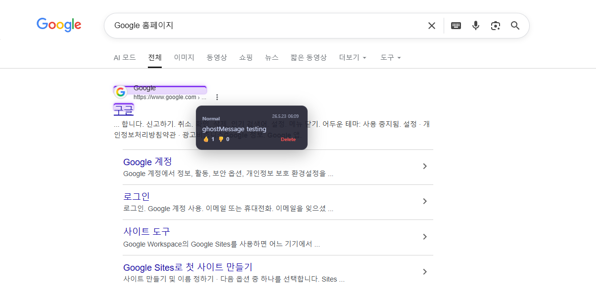
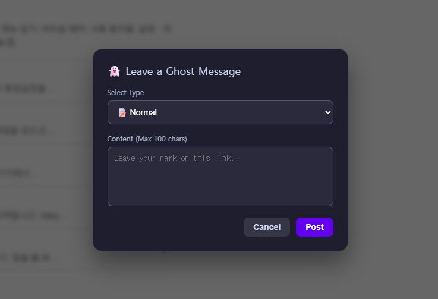
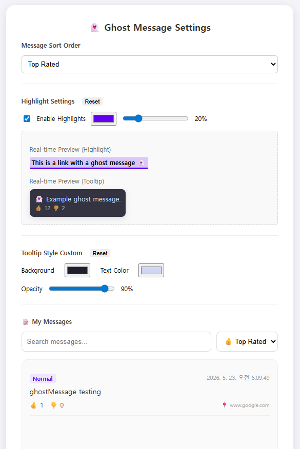
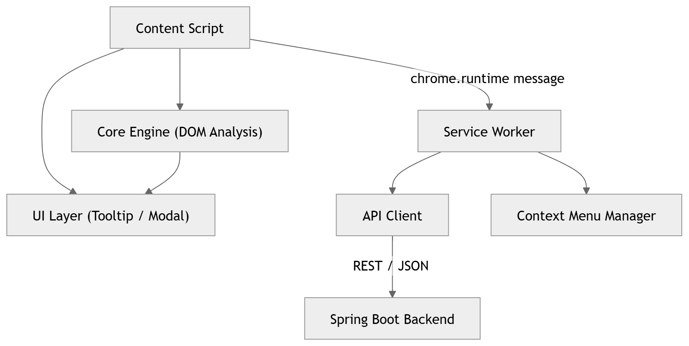
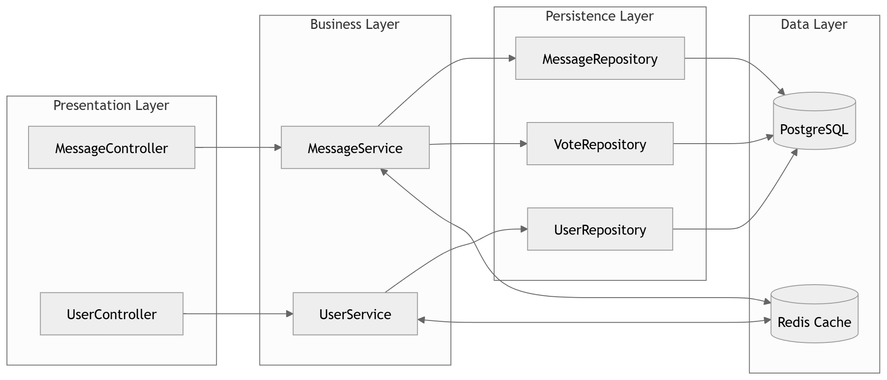

# ghostMessage (유령 메시지)

---

## 프로젝트 소개 및 개발 배경

**"웹 전체를 비동기 멀티플레이 공간처럼 만드는 것"**

ghostMessage 는 웹페이지의 특정 요소 위에 다른 사용자들이 남긴 짧은 메시지를 “유령 흔적”처럼 표시하는 브라우저 확장 기반 소셜 레이어입니다. 다크소울이나 엘든링의 메시지 시스템에서 영감을 받아, 웹을 탐험하며 누군가 먼저 지나갔다는 느낌과 우연한 발견의 즐거움을 제공합니다.

이 서비스는 다음의 문제를 해결하고자 개발되었습니다:

- **웹 페이지 정보의 고립**: 페이지 자체의 댓글 창이 없거나 활성화되지 않은 곳에서도 소통할 수 있도록
- **전통적 SNS의 피로도**: 프로필, 타임라인, 스레드 등의 복잡함을 제거한 순수한 맥락적 정보 공유
- **페이지 맥락의 부재**: 다른 사용자가 해당 링크에 남긴 팁, 경고, 짧은 메시지를 페이지에서 바로 확인

---

## 주요 기능

### 1. 앵커 기반 메시징 (Anchor-based Messaging)
- 웹페이지 내 특정 링크(`<a>` 태그)를 대상으로 메시지 작성
- 페이지 URL과 링크 URL(`anchorKey`)로 메시지를 조회하고, 저장된 요소 정보로 표시 대상을 필터링

### 2. 호버 툴팁 (Hover Tooltip)
- 링크 위에 마우스를 올리면 즉시 해당 요소에 달린 메시지 목록 표시
- 최신순, 추천순 정렬 지원

### 3. 추천 시스템 (Vote System)
- 메시지에 대한 추천(Upvote) 및 비추천(Downvote) 기능
- 설정에 따라 추천 점수순으로 메시지 정렬

### 4. 링크 하이라이트 & HUD
- 메시지가 존재하는 링크에 미세한 글로우(Glow) 효과를 주어 탐험 유도
- HUD(Heads-Up Display)를 통해 현재 페이지의 메시지 통계 및 사용자 정보 제공

---

## 프로젝트 데모

### 주요 화면 (예시)

#### 메시지 발견 및 호버 툴팁

- 링크 호버 시 나타나는 미니멀한 메시지 팝업
- 메시지 타입 및 작성일시 제공 및 추천 기능 지원

#### 메시지 작성 UI

- 링크에서 우클릭 후 메시지 작성 모달 오픈 가능

#### HUD

- 페이지 좌하단의 HUD를 통한 현 페이지의 메시지 수, 잔여 행동 횟수 및 한도 초기화까지 남은 시간 시각화

#### 익스텐션 설정 페이지

- 메시지 정렬 기준, 색상 변경 및 작성 메시지 조회 지원

---

## 기술 스택

### Backend
- **Java / Spring Boot**: 계층형 구조를 통한 비즈니스 로직의 명확한 분리
- **Spring Data JPA**: 엔티티 기반의 효율적인 데이터 접근 및 객체-관계 매핑
- **Redis**: 페이지 메시지 조회 캐시와 보안 코드 검증 시도 횟수 관리

### Database
- **PostgreSQL**: 안정적인 관계형 데이터 저장 및 복잡한 쿼리 처리

### Frontend
- **JavaScript (Vanilla) / HTML / CSS**: 링크 하이라이트와 메시지 UI를 제공하는 확장 프로그램 구현
- **Chrome Extension API (MV3)**: 최신 브라우저 보안 규격 준수 및 백그라운드 서비스 워커 활용

### Infra & Tools
- **Docker / Docker Compose**: 개발 및 운영 환경의 일관성 보장
- **Gradle**: 의존성 관리 및 빌드 자동화

---

## 아키텍처 (Architecture)

본 프로젝트는 각 컴포넌트 간의 독립성을 보장하고 유지보수성을 높이기 위해 명확한 계층 분리 및 메시지 패싱 구조를 채택했습니다.

### 1. 시스템 시각화

#### 프론트엔드 (Chrome Extension)
프론트엔드는 사용자의 브라우징 경험을 방해하지 않도록 웹페이지와 격리된 구조를 가지며, 백그라운드 스크립트를 통해 중앙 집중식 API 통신을 수행합니다.

 

#### 백엔드 (Spring Boot)
백엔드는 **계층형 아키텍처(Layered Architecture)**로 요청 처리, 비즈니스 로직, 데이터 접근을 분리하고, 페이지 메시지 조회에 Redis 캐시를 사용합니다.

### 2. 설계 원칙
- **관심사 분리 (SoC)**: 백엔드는 핸들러-서비스-리포지토리 구조를 통해 비즈니스 로직과 데이터 접근 로직을 분리했습니다.
- **메시지 기반 통신**: 익스텐션 내부의 복잡한 로직을 백그라운드 서비스 워커로 위임하여 컨텐츠 스크립트의 부하를 최소화했습니다.

---

## 인프라 및 배포 (Deployment & Infrastructure)

본 프로젝트는 Docker Compose로 애플리케이션, PostgreSQL, Redis를 운영합니다. 외부 HTTPS 요청은 VM 호스트의 Nginx를 거쳐 애플리케이션으로 전달됩니다.

### 1. 배포 아키텍처
Chrome 확장 → Nginx/HTTPS → `127.0.0.1:8080`의 Spring Boot 앱 → PostgreSQL·Redis

### 2. 컨테이너 구성 및 리소스 관리
앱·DB·Redis 컨테이너에는 메모리 제한(`mem_limit`)과 재시작 설정(`restart: always`)이 적용되어 있습니다.

- **App Server (ghost-app)**: JVM 힙을 `-Xms128m -Xmx384m`으로 설정했습니다.
- **DB Server (ghost-db)**: PostgreSQL 15 기반으로, 호스트 시스템과의 볼륨 바인딩을 통해 데이터의 영속성을 보장합니다.
- **Cache Server (ghost-redis)**: Redis 7 기반으로, `maxmemory 64mb`, `allkeys-lru`와 AOF 영속화를 설정했습니다.

---

## 주요 문제 해결 과정

### 1. 페이지 메시지 반복 조회 줄이기
- **문제**: 확장이 같은 페이지의 메시지를 주기적으로 다시 조회해 DB 조회가 반복됩니다.
- **해결**: **Redis 페이지 캐시**를 적용하고 메시지 생성·투표·삭제 시 관련 캐시를 무효화합니다.
- **결과**: 제한된 로컬 환경의 50 VU·20초 측정에서 예열된 캐시 적용 후 메시지·작성자 SELECT가 각각 981회에서 0회로 줄었습니다. 운영 Nginx 경로의 100건 페이지를 10 VU·20초로 재측정한 두 번째 실행에서는 p95가 캐시 Off 364ms, On 185ms였습니다.

### 2. 투표 점수와 사용자 한도 갱신
- **문제**: 동시 요청 시 메시지 점수와 사용자별 일일 한도 값이 충돌할 수 있습니다.
- **해결**: 투표 대상 메시지는 **비관적 락**으로 조회하고, 사용자 엔티티에는 `@Version`을 적용했습니다.
- **결과**: 동일 메시지의 투표 점수 갱신을 직렬화하고 사용자 값의 동시 변경을 감지하도록 구성했습니다.

### 3. 페이지 위 메시지 표시
- 링크 하이라이트와 호버 툴팁을 CSS 및 요소 스타일로 구현했습니다.

### 4. 동적으로 추가되는 링크 처리
- 페이지 URL과 링크 URL로 메시지를 찾고 CSS Selector·링크 텍스트·이미지 URL로 표시 대상을 필터링합니다.
- `MutationObserver`로 새로 추가된 링크를 감지해 하이라이트를 다시 적용합니다.
